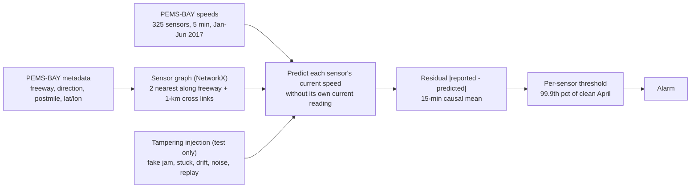
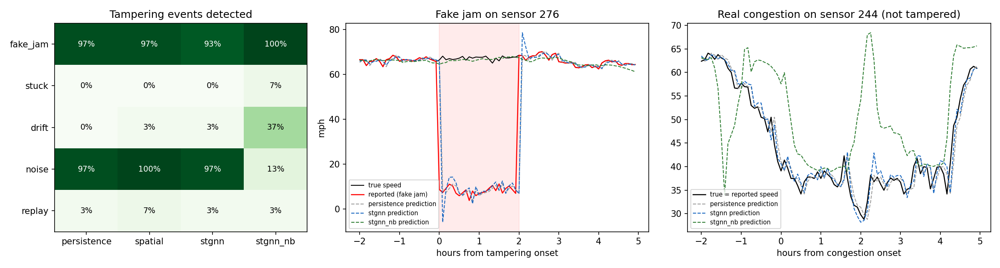

# arterial-sensor-tamper-gnn

**Is that jam real, or is the detector lying?** A spatio-temporal graph network predicts what each loop
detector *should* read from its neighbours. Tampering shows up as disagreement with the network, while real
congestion is spatially coherent and shows up at the neighbours too. Evaluated on **real PEMS-BAY data**
(325 Caltrans sensors, 6 months) with 150 injected tampering events: fake jams, stuck values, slow drift,
noise and replayed data.

**Headline (61 test days, May-June 2017):**

* **Abrupt tampering is caught.** Fake jams and noise: 93-100% of events, mostly within 0-10 minutes, at 0.16%
  false alarms on clean data (GNN with the sensor's own history).
* **Subtle tampering beat every history-based model.** Stuck values, slow drift and yesterday's replayed data:
  0-7% detected. The cause is my own first design, explained in Section 4.
* **A neighbours-only GNN fixed part of that, at a price.** Fake jams 100% (AUC 0.997) and drift 37% (from 3%).
  But it is a less precise predictor (2.8 vs 0.9 mph error), so it misses most noise attacks and raises three
  times the false alarms, mostly in real congestion. No single detector wins; they are complementary.

---

## 1. Problem formulation

Traffic management centres act on detector data: ramp metering, incident detection, traveller information,
adaptive signals. A compromised or failing detector that reports a fake queue can divert traffic or trigger
control actions. The engineering challenge is that real congestion also makes speeds collapse suddenly, so
"sudden drop" cannot be the alarm. The useful difference is *spatial*: real congestion has upstream and
downstream signatures, a lone tampered sensor does not.

| Bar | Here |
|---|---|
| **Traffic engineering** | Real freeway detector network (PEMS-BAY), free-flow and congestion regimes, false alarms reported separately for real congestion |
| **ML** | Spatio-temporal GNN (GRU + weighted message passing) in PyTorch, neighbour-corruption training augmentation, per-sensor thresholds from clean validation data, event-level and sample-level metrics |
| **Systems** | Sensor graph built from metadata with NetworkX (no unpickling of downloaded files), FastAPI scoring service, Docker |

---

## 2. Architecture



---

## 3. Methodology

**Data.** PEMS-BAY (Li et al., DCRNN, 2018): 5-min average speeds from 325 Bay Area sensors, January-June 2017,
from the CSV mirror on Zenodo (record 5146275). Missing samples (zeros) are forward-filled. Training is
January-March, threshold calibration April (clean), test May-June with tampering injected.

**Graph.** Each sensor is linked to its two nearest neighbours upstream and downstream on the same freeway
and direction (by postmile), plus any sensor within 1 km (interchanges): 1,329 edges, weighted by a Gaussian
kernel of distance. The distributed `adj_mx_bay.pkl` was deliberately not used, because unpickling a
downloaded file can execute code.

**Predictors** (none sees the sensor's own current reading):

| Method | Predicts sensor $i$ at time $t$ from |
|---|---|
| persistence | its own previous reading $x_{i,t-1}$ |
| spatial | $x_{i,t-1}\,\bar x_{\mathcal N(i),t}/\bar x_{\mathcal N(i),t-1}$: its last reading, scaled by how its neighbours changed |
| stgnn | GRU over its last hour + weighted message passing of neighbours' history and current readings; predicts a correction to $x_{i,t-1}$ |
| stgnn_nb | the same network without the sensor's own history; a learned per-sensor embedding gives its level relative to its neighbours |

The GNNs were trained with 5% of neighbour inputs randomly corrupted, so they do not follow one odd neighbour
blindly. **Detection**: the 15-min causal mean of $|x - \hat x|$ above the sensor's 99.9th percentile on clean
April data (floor 5 mph).

**Tampering** (150 events of 1-3 h, 30 of each type): `fake_jam` (8-20 mph), `stuck` (value frozen at onset),
`drift` (bias growing to -25 mph), `noise` (sd 15 mph), `replay` (its own readings from 24 h earlier).

---

## 4. Results ([`results/pems_bay/RESULTS.md`](results/pems_bay/RESULTS.md))



**Events detected (30 per type) and sample-level ROC AUC.**

| Tampering | persistence | spatial | stgnn | stgnn_nb |
|---|---|---|---|---|
| fake_jam | 97% (0.870) | 97% (0.831) | 93% (0.925) | **100% (0.997)** |
| stuck | 0% (0.021) | 0% (0.308) | 0% (0.093) | 7% (0.550) |
| drift | 0% (0.692) | 3% (0.634) | 3% (0.740) | **37% (0.859)** |
| noise | 97% (0.993) | **100% (0.992)** | 97% (0.994) | 13% (0.924) |
| replay | 3% (0.541) | 7% (0.588) | 3% (0.548) | 3% (0.538) |

**False alarms on clean samples.**

| Method | Prediction error, April (mph) | All | In real congestion | In free flow | Alarm episodes per sensor-day |
|---|---|---|---|---|---|
| persistence | 0.94 | 0.18% | 1.15% | 0.12% | 0.28 |
| spatial | 1.10 | 0.19% | **0.82%** | 0.15% | 0.30 |
| stgnn | **0.88** | **0.16%** | 1.29% | **0.09%** | 0.23 |
| stgnn_nb | 2.83 | 0.48% | 4.53% | 0.24% | 0.23 |

**Engineering reading.**

* **My first design had a blind spot, and the numbers show exactly where.** Every predictor that uses the
  sensor's own recent history follows a lie once it has started. A stuck sensor predicts itself perfectly, so
  its residual is *smaller* than normal: AUC 0.02-0.09, worse than chance. Drift and replay are smooth, so the
  prediction tracks them too. A more accurate forecaster (stgnn has the lowest error) does not fix this; it is
  structural.
* **Removing the sensor's own history fixes the structure and costs precision.** The neighbours-only model
  catches fake jams almost perfectly and a third of drifts. But neighbours explain a sensor less well than its
  own past (2.8 vs 0.9 mph error), so thresholds are wider: noise slips through and false alarms triple,
  mostly in real congestion, where neighbouring sensors disagree most. A deployed system should run both and
  combine them, with a simple "zero variance for 30 minutes" rule for stuck sensors.
* **Real congestion is still the hardest condition for every method:** 0.8-4.5% false alarms there, against
  0.1-0.2% in free flow. The spatial-ratio baseline is best in congestion, because it encodes exactly the
  physical idea that neighbours slow down together.
* **Replay is undetectable by content alone** (AUC about 0.54 everywhere). Yesterday's traffic at the same time
  looks like normal traffic. That calls for message authentication and timestamps, not a better model.

---

## 5. Layout, reproduce, limitations

```
src/sensorguard/data.py     PEMS-BAY loading, sensor graph from metadata
src/sensorguard/tamper.py   five tampering types
src/sensorguard/models.py   persistence, spatial ratio, STGNN and neighbours-only STGNN, training
src/sensorguard/study.py    calibration, evaluation, figures, report ; api/app.py ; cli.py
tests/ (7 tests: graph construction, spatial prediction, tamper injection, no self-leakage in the GNN,
        GNN learns a coherent network, splits and smoothing, API)
```

```bash
python -m venv .venv && .venv/Scripts/activate
pip install torch==2.5.1 --index-url https://download.pytorch.org/whl/cpu
pip install -r requirements.txt && pip install --no-deps -e .
pytest
# PEMS-BAY.csv and PEMS-BAY-META.csv from https://zenodo.org/records/5146275 into data/pems
sensorguard study --data data/pems          # ~30 min on CPU (two GNNs)
docker build -f docker/Dockerfile -t sensorguard . && docker run -p 8000:8000 sensorguard
```

**Limitations.** Freeway sensors, not arterial detectors (no signal effects); tampering is injected, so its
realism is assumed; one random seed for injection; PyTorch Geometric and DGL were not needed for a
325-node graph (plain PyTorch message passing); tampered sensors also corrupt their neighbours' inputs, which
the training augmentation only partly addresses.

## License

MIT
