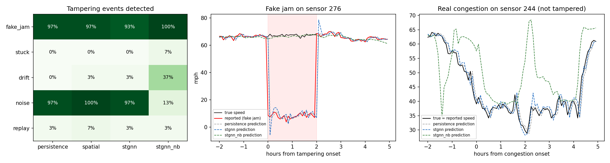

# Sensor tampering vs real congestion on PEMS-BAY

325 sensors, 1329 graph edges; 150 tampering events (1-3 h) injected into 61 test days (May-Jun 2017); 5.7% of test samples are real congestion.

## Events detected / median time to detect (min) / sample AUC

| Attack | persistence | spatial | stgnn | stgnn_nb |
|---|---|---|---|---|
| fake_jam | 97% / 0 / 0.870 | 97% / 0 / 0.831 | 93% / 0 / 0.925 | 100% / 8 / 0.997 |
| stuck | 0% / - / 0.021 | 0% / - / 0.308 | 0% / - / 0.093 | 7% / 100 / 0.550 |
| drift | 0% / - / 0.692 | 3% / 25 / 0.634 | 3% / 50 / 0.740 | 37% / 100 / 0.859 |
| noise | 97% / 10 / 0.993 | 100% / 10 / 0.992 | 97% / 5 / 0.994 | 13% / 28 / 0.924 |
| replay | 3% / 10 / 0.541 | 7% / 2 / 0.588 | 3% / 10 / 0.548 | 3% / 15 / 0.538 |

## False alarms on clean samples (thresholds: per-sensor 99.9th percentile of clean April scores)

| Method | Prediction MAE (mph, Apr) | All clean | In real congestion | In free flow | Next to a tampered sensor | Episodes per sensor-day |
|---|---|---|---|---|---|---|
| persistence | 0.94 | 0.178% | 1.154% | 0.120% | 0.206% | 0.276 |
| spatial | 1.10 | 0.189% | 0.823% | 0.151% | 0.864% | 0.295 |
| stgnn | 0.88 | 0.161% | 1.294% | 0.093% | 0.148% | 0.232 |
| stgnn_nb | 2.83 | 0.480% | 4.532% | 0.237% | 3.392% | 0.228 |

STGNN training: 12.9 min on CPU; validation MAE by epoch: 0.96, 0.94, 0.93, 0.91, 0.90, 0.90; neighbours-only: 3.50, 3.21, 3.04, 2.99, 2.85, 2.82

